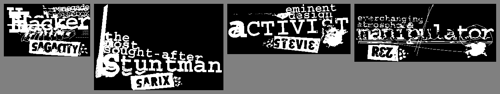
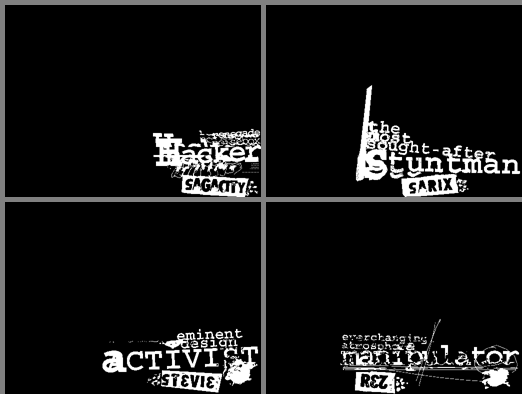
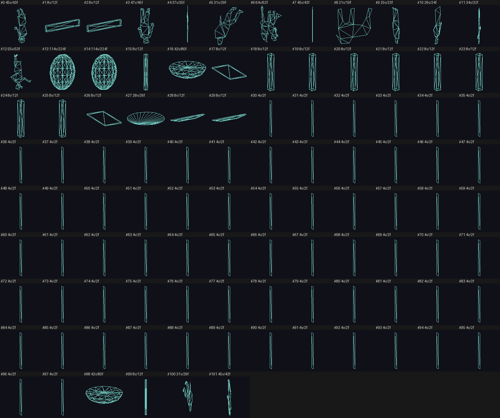
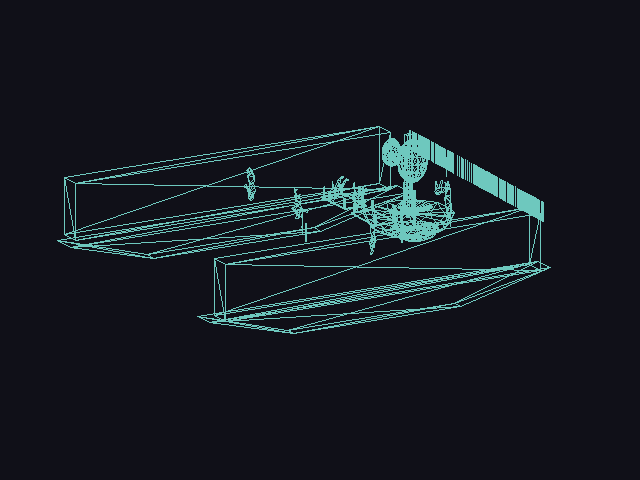

# 3s-money (Three State "antimoney", 64k) - effects

Status: partial. Ported: slot 3 (star/kaleidoscope), slot 13 (images), grain. Everything else is documented below but not ported. See `README.md` for the honest table.

## Structure
- 25 effect "slots" (12-byte records at 0x431838: init, per-frame, command handler). Every frame all per-frame callbacks run; each tests its own enable flag.
- A 60-entry script (0x415250: time = order<<8|row, slot, command, float) fires from the tracker position. Command 0 with 1.0 enables, otherwise disables; 2 on slot 0 sets the palette level; 6/7/8 are slot specific parameters. So the picture is a function of (music position, clock): seek = set the module position.
- Output is 8-bit 512x384 (shown 4:3). The palette is always two-valued: indices below a level `v` are white, the rest black (0x40c691). All "brightness" in the demo is therefore a threshold on an additive 8-bit accumulator: effects add into the screen buffer with saturating or wrapping byte adds and the level decides what is white. Level changes (fades, pulses) are the main visual dynamic.

## Slot 3: star lines through a polar warp
A 256x256 byte texture is cleared each frame and 120 iterations add (+0x3f saturating) horizontal and vertical lines whose lengths follow `100 - trunc(sin(k*0.01 + a) * -128)` and whose positions follow `log10` spacing (`LG[119]-LG[120-k]`), with amplitudes `sin(a)*40+50`, `cos(a)*40+50`, a = t*0.005 (t = timeGetTime()/10). The screen is that texture read through a 512x384 table of words (radius -> column, angle -> row), which turns the grid of lines into the dotted star / rings. Command 6 fixes the vertical line length (0x42725c), command 7 switches off the horizontal lines and enables a scrolling text overlay (text itself is GDI and blank in our emulation), command 8 renders the overlay text.
Check: texture bit-exact vs the original routine under Unicorn (grain off); golden frames agree outside the grain range on every pixel (orders 0-2 and 14-16). Note the loop runs 119 times (the log table pointer stops at index 118), not 120.

## Slot 13: images
Four 512x384 pictures built at init from embedded bitmaps (`v = (255-v) & 0x7f`), added with `paddusb` to the screen; command 6 selects the image (0..3 at orders 12-14). We ship the four images dumped from the emulator (`web/assets/fx13.bin`).

## Slot 24: grain
768x512 buffer of `rand() & 31`, added (wrapping `paddb`) at a random offset `rand() % 0x30000` every frame. Not reproducible without the MSVCRT LCG state, approximated with `Math.random`.

## Slot 22: zoom/glow
After the other effects, the screen is halved and four mirrored quadrants (256x192, sampling walks outwards from the centre at a fixed-point step of 0xfe/256 per pixel) add `LUT[0x80 + bilinear]` to each pixel in place, so every pixel is blended with an already-zoomed neighbour: a recursive blur/zoom that turns hard lines into the soft noise floor seen in orders 18-20. Then x2. MMX details: the 16-bit lane low bytes are junk from earlier registers (see NOTES). Port is within +-1..3 LSB of the original.

## 2D/3D art used

The demo is a single UPX-packed PE with no other data files (the folder holds only the exe and text files), so all art lives in the unpacked image (`re/unpack_upx_pe.py` runs the UPX stub under Unicorn and dumps 0x400000..0x4c9000 to `re/image.bin`, 823,296 bytes; offsets below are virtual addresses, file offset = address - 0x400000). Facts were re-derived from the disassembly (`re/img_all.dis`) and by decoding the bytes; previews are in `figures/`.

### Embedded 1-bit pictures (slot 13, 4 images)
* **Where and format**: four blobs at **0x415430, 0x416330, 0x418820, 0x419c9c**. Each is `u16 width, u16 height` then `(width/8) * height` bytes of **1 bit per pixel**, row by row, bit 0 of a byte = the *rightmost* pixel of its group of 8. No palette, no colour: the demo's palette is always two-valued (section "Structure").
  Sizes: 224x137 (3836 bytes), 336x225 (9450), 320x131 (5240), 368x151 (6946).
* **Unpacking** (init 0x4019e0 of slot 13, blitter 0x40c5b8 via 0x40c50a): four 512x384 byte buffers (0x30000 each) are filled with 0xff; each bitmap is expanded to bytes (bit 1 -> 0xff, bit 0 -> 0x00) at destination **(288,247), (176,159), (192,253), (144,233)**; then every byte becomes `(255 - v) & 0x7f`, i.e. **picture pixels (bit 0) = 0x7f, everything else 0**. At run time the buffer is added with `paddusb` to the screen, so they show as white shapes on black after the palette threshold.
* **Check**: decoding the blobs this way reproduces the emulator's dump `re/fx13.raw` (`web/assets/fx13.bin`) with **0 differing bytes in all four buffers**; the pixels outside the bitmap rectangles are 0.
* **Content** (what the pictures show): stylised credit cards with big type and a name label: "hacker ... SAGACITY", "the most sought-after stuntman ... SARIX", "eminent design activist ... STEVIE", "everchanging atmosphere manipulator" with a fourth tag.

### 3D meshes: one embedded scene of 102 objects (slot 11)
* **Where**: a 13,849-byte block at **0x411464..0x414a7d** (the argument of the loader call at 0x403d9c, size 0x3619), loaded by the init of slot 11 (0x403d70, scene object 0x42b708) through the chunk reader 0x407d80 (error strings `CHK_HELPER/CAMERA/MESH/SCENE` at 0x415208 show it is modelled on a 3DS-style chunk loader). It is the only caller of that loader.
* **Format** (read from handlers 0x407b90 / 0x407ba5 and the byte stream): chunk = `u8 id, u16 length` (length includes the 3-byte header). The block is one chunk `0x10` (length 13849; its handler reads two `u16`), followed by **102 chunks of id 0x20** (mesh) that tile the block exactly. Mesh chunk: `u8 nverts, u16 nfaces`, `nverts * 3 * s16` coordinates (the loader divides each by 255 to get a float), `nfaces * 3 * u8` triangle indices, then 14 bytes the mesh handler does not read (their meaning was not determined). The loader also draws **six `rand()` values per face, scaled by 1/256**, into the face record (use not determined, so face attributes that depend on `rand()` are not stored in the file).
* **Totals**: 1,246 vertices, 1,442 triangles; per mesh 4..114 vertices and 2..224 faces. 68 objects are 4-vertex / 2-face quads, 16 are 8-vertex / 12-face boxes (including two long slabs, objects 1 and 2, 150 x 25 x 10 units), 2 are 114 v / 224 f ellipsoids, 2 are 42 v / 80 f bowls, and 14 more are irregular pieces of 21..64 vertices (n-2 faces). Coordinates span x -106..74, y -1.6..44, z -79..65 (units of the /255 scale). The wireframe shows all 102 objects as stored, in a fixed view.
* **Status**: slot 11 is not ported (README), so these meshes are only decoded here, not used by the web player.

### Text and fonts (GDI, rasterised at run time)
No glyph data is in the exe: text is drawn by the OS through `CreateFontA` (helper 0x40bd64: face, height, bold flag) and `TextOutA` into a DIB (helper 0x40bd9a), which is why it is blank in the emulator. Faces and heights seen at the call sites: **Impact** (0x411034) at heights 200, 150, 100, 50 and a variable one, **Arial** (0x411094) at 31 and a variable one, **Courier** (0x414a90) at 10 and 16. Strings (in the image): `i am not feeling so coca cola today` (0x411010), `work consume sleep ...` (0x41103c), `antimoney` (0x4110a0), five Courier paragraphs from 0x414ab0 (e.g. "Less than an  hour after I step off the plane, ..."), `3state` / `sleep` / `consume` (0x414a88..), `reported TRAFFIC heavy` (0x4151a4), and `antimoney - www.threestate.com - work - consume - sleep` (0x41b7cc).
Slot 3's init (0x401220) allocates a **3584x200** byte texture (0xaf000 bytes) and renders the Impact-200 sentence into it.

### Generated by code
* **Slot 3**: a 256x256 line texture (0x10000 bytes) redrawn every frame and a 512x384 table of words (0x60000 bytes: radius -> column, angle -> row) built at init (section "Slot 3").
* **Slot 24 grain**: 768x512 bytes of `rand() & 31`.
* **Slot 22**: a 256-byte LUT built at init (`LUT[i] = clamp(i*f)`).
* **Slot 12 3D scene**: not stored at all; a 7x7x7 grid, "walker" polylines and about 171 cubes are generated by code (`web/fx/slot12.js`; README, "Slot 12").
* **Slot 5 icosphere**: 162 vertices / 320 faces generated by code (subdivided icosahedron, slerped edges, radius 150) and a 256x256 radial-gradient texture; bit-exact vs the emulator with the grain off (`web/fx/slot5.js`, `re/NOTES.md` Update 5).
* **Images 0..3 in the player**: stored as the emulator dump `web/assets/fx13.bin`, 4 x 196,608 bytes.

## Not ported
3D engine scenes (slots 10, 11, 14, 17, 18: shared software engine at 0x407000-0x40bd00, mesh loader 0x407d80, polygon 0x407370, camera 0x409a71), GDI text effects (16, 22, 23, 15, text overlays), rand-driven slot 4. Slots 4, 5, 12, 15 and 18 are ported bit-exact against the original under Unicorn (grain off; slot 15 is a 256x256 voxel terrain marched per column with a sin-driven palette level, slot 18 three Hermite-spline wire curves drawn with a 13-pixel brush, palette ramp `(pos-0x1a00)*2.5+100`; see `re/NOTES.md` Update 6). The text of slots 4 and 18 is approximated with canvas text. The palette level of the 11/13 era is still fitted to the golden run in `web/fx/compose.js`.
